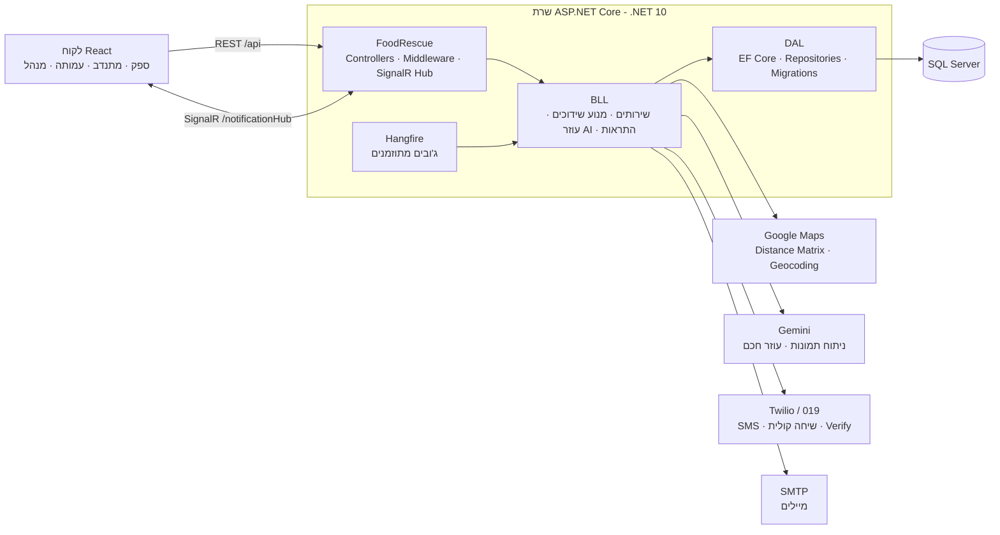
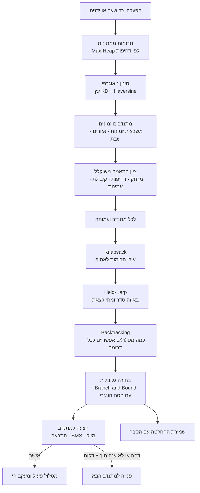

# לתת באהבה – מערכת להצלת מזון (Food Rescue)


מזון טוב נזרק כל יום, בזמן שעמותות מחפשות אותו. **לתת באהבה** מחברת בין שלושה צדדים: **ספקים** (עסקים עם עודפי מזון), **מתנדבים** שנוהגים, ו**עמותות** שמחלקות את המזון.

הלב של המערכת הוא **מנוע שידוכים אוטומטי**. המנוע מחליט איזה מתנדב יאסוף אילו תרומות, באיזה סדר, מתי לצאת ולאיזו עמותה להביא. הוא מתחשב בתוקף המזון, בזמינות המתנדבים, בשעות הקבלה של העמותות, בקיבולת הרכב ובשבת. על כל החלטה הוא יודע להסביר **למה** החליט כך.

> הריפו הזה הוא צד השרת. צד הלקוח (React) נמצא ב-[my-react-client](https://github.com/hadasbenamram-debug/my-react-client).

---

## תוכן העניינים
- [מה המערכת עושה](#מה-המערכת-עושה)
- [ארכיטקטורה](#ארכיטקטורה)
- [מנוע השידוכים](#מנוע-השידוכים)
- [האלגוריתמים](#האלגוריתמים)
- [טכנולוגיות](#טכנולוגיות)
- [הרצה מקומית](#הרצה-מקומית)
- [הגדרות](#הגדרות)
- [בדיקות](#בדיקות)
- [ג'ובים מתוזמנים](#גובים-מתוזמנים)
- [מבנה הפרויקט](#מבנה-הפרויקט)

---

## מה המערכת עושה

| תפקיד | מה אפשר לעשות |
|---|---|
| **ספק** | הרשמה עם רישיון עסק ואישור מנהל. יצירת תרומה עם תמונה, ו-AI מזהה את המוצרים ומשייך אותם לקטגוריות. מעקב אחרי האיסוף ושיחה על כל תרומה. |
| **מתנדב** | הרשמה עם רישיון נהיגה. מערכת שעות שבועית. קבלת הצעות מסלול באפליקציה, ב-SMS ובמייל, ואישור או דחייה גם מקישור. מסלול פעיל עם ניווט, היסטוריית שיבוצים ודירוגים. |
| **עמותה** | שעות קבלה (כולל מוצאי שבת) וקיבולת יומית בק"ג. מעקב חי אחרי תרומות בדרך, אישור קבלה ודירוג המתנדב. |
| **מנהל** | לוח בקרה, אישור משתמשים, ניהול תרומות, **חדר בקרה חי** עם רכבים על המפה, הרצה ידנית של המנוע, שיבוץ ידני עם סיבת כישלון מדויקת, טיפול במתנדבים שלא הגיעו (No-Show), דוחות, ושינוי משקלי המנוע מתוך המסך. |
| **כולם** | התראות בזמן אמת (SignalR), עוזר חכם בצ'אט (Gemini עם כלים לפי תפקיד), אימות טלפון במסרון או בשיחה קולית, ואיפוס סיסמה בקישור למייל או בקוד לטלפון. |

---

## ארכיטקטורה



השרת בנוי בשכבות, וכל שכבה היא פרויקט נפרד:

| פרויקט | תפקיד |
|---|---|
| `FoodRescue` | שכבת ה-API: Controllers, Middleware לטיפול בשגיאות, SignalR Hub, אימות JWT, Rate Limiting, Swagger ולוח Hangfire |
| `BLL` | הלוגיקה העסקית: מנוע השידוכים והאלגוריתמים, העוזר החכם, תור ההתראות, אבטחה |
| `DAL` | ישויות, `FoodRescueDbContext`, Repositories ו-Migrations של EF Core |
| `DTOs` | אובייקטים שעוברים בין השרת ללקוח |
| `Tests` | בדיקות xUnit |

כללי השכבות נאכפים בבדיקות (`ArchitectureTests`): Controllers עובדים רק מול ממשקי שירות ו-DTOs, ואף פעם לא מול ישויות או Repositories.

---

## מנוע השידוכים

המנוע רץ אוטומטית כל שעה (Hangfire, לפי `MatchingPolicy:EngineCron` בשעון ישראל). מנהל יכול גם להריץ אותו ידנית.



**הדחיפות** מחושבת בזמן אמת לפי הזמן שנשאר עד המועד האחרון לאיסוף:

$$\text{urgency} = 100 \cdot e^{-\frac{\text{minutes left}}{\tau \,/\, \text{perishability}}}$$

τ הוא קבוע זמן, ו-perishability הוא מקדם המתכלות של סוג המזון, כך שמזון מתכלה "מזדקן" מהר יותר. ברגע האחרון הדחיפות היא 100.

**ציון ההתאמה** של מתנדב לתרומה הוא שקלול של ארבעה רכיבים, כל אחד מנורמל ל-0–1. המרחק הוא מרחק נסיעה אמיתי בכביש מ-Google Distance Matrix.

| רכיב | משקל ברירת מחדל |
|---|---|
| מרחק | 0.35 |
| דחיפות | 0.30 |
| אמינות המתנדב (מתעדכנת אחרי כל משוב וכל No-Show) | 0.20 |
| קיבולת פנויה ברכב | 0.15 |

**אילוצים קשים** שכל מסלול חייב לעמוד בהם: מועדי איסוף ותפוגה, "זמינה לאיסוף החל מ-", שעות הקבלה וקיבולת יומית של העמותה, חלון הזמינות של המתנדב, קיבולת הרכב, ושמירת שבת. זמני השבת מחושבים מקומית לפי אלגוריתם השקיעה של NOAA.

**"למה המנוע החליט כך":** בכל מסלול נשמרים המועמדים שנשקלו, רכיבי הציון של כל אחד, ולמה כל מועמד לא נבחר: ערך נמוך יותר, נלקח על ידי מסלול אחר, או אין מסלול אפשרי, עם הסיבה המדויקת. המנהל רואה את כל זה במסך ייעודי.

---

## האלגוריתמים

כל האלגוריתמים ממומשים בקוד, בלי ספריות חיצוניות. המרכזיים שבהם נבדקים מול פתרון Brute-Force על אלפי מקרים אקראיים.

| אלגוריתם | קובץ | שימוש | סיבוכיות |
|---|---|---|---|
| Max-Heap עם אינדקס מפתחות | `PriorityHeapService.cs` | סדר הטיפול בתרומות לפי דחיפות | עדכון והסרה O(log n), בנייה O(n) |
| עץ KD דו-ממדי + Haversine | `GeoKdTree.cs` | מתנדבים ותרומות ברדיוס, לפני כל פנייה ל-Google | בנייה O(n log² n), חיפוש O(√n + k) |
| Merge Sort / Quick Sort | `VolunteerSortingService.cs` | דירוג המתנדבים לפי ציון ההתאמה | O(n log n) |
| Knapsack 0/1 עם מגבלת קטגוריה | `KnapsackSolver.cs` | אילו תרומות נוספות לאסוף באותו מסלול | O(n·K·W + C·W·B) |
| Held-Karp (תכנון דינמי) | `RoutePlanner.cs` | סדר התחנות ושעת היציאה תחת חלונות זמן | O(2^m · m²), עד 12 תחנות |
| Backtracking | `BacktrackingAssignmentService.cs` | חיפוש מסלולים אפשריים, עם חזרה למתנדב הבא כשאילוץ נכשל | תלוי במספר המועמדים |
| Branch and Bound | `BacktrackingAssignmentService.cs` | בחירה גלובלית בין המסלולים של כל התרומות | גיזום לפי חסם עליון מוכח |
| השיטה ההונגרית (Kuhn-Munkres) | `HungarianAlgorithm.cs` | החסם העליון של ה-Branch and Bound (הרפיית לגרנז') | O(n² · m) |
| חישוב שקיעה (NOAA) | `ShabbatClock.cs` | כניסת השבת וצאתה | O(1) |
| עץ תגובות רקורסיבי | `CommentTreeService.cs` | שיחה מקוננת על כל תרומה | O(n) |

בטבלה: n הוא מספר הפריטים, k מספר התוצאות, m מספר התחנות במסלול, W הקיבולת ביחידות משקל, K התקרה לקטגוריה, C מספר הקטגוריות ו-B מספר "נקודות השבירה".

כשה-Branch and Bound מסיים את החיפוש, הפתרון **מוכח אופטימלי** מבין המסלולים המועמדים. אם החיפוש נעצר בתקרת הצמתים, המנוע מדווח כמה רחוק הפתרון יכול להיות מהאופטימום, באחוזים.

---

## טכנולוגיות

**שרת:** .NET 10, ASP.NET Core Web API, Entity Framework Core 10 + SQL Server, AutoMapper, Hangfire, SignalR, JWT, Rate Limiting, Swagger, ImageSharp, Microsoft.Extensions.AI (Gemini).

**לקוח:** React 18, TypeScript, Vite, MUI עם תמיכה מלאה ב-RTL, React Router, SignalR, Google Maps.

**שירותים חיצוניים:** Google Maps (Distance Matrix, Geocoding, Static Maps), Gemini, Twilio (Verify, SMS ושיחות קוליות) או 019, Hebcal (חגים, לעוזר החכם), SMTP.

---

## הרצה מקומית

### דרישות
- [.NET 10 SDK](https://dotnet.microsoft.com/download)
- SQL Server או LocalDB (מגיע עם Visual Studio)
- Node.js 20 ומעלה, ללקוח
- מפתח Google Maps API

### שרת
```bash
git clone https://github.com/hadasbenamram-debug/my-server.git
cd my-server
dotnet tool restore

# הגדרות חובה - נשמרות ב-User Secrets, לא בקוד
dotnet user-secrets set "ConnectionStrings:DefaultConnection" "Server=(localdb)\MSSQLLocalDB;Database=FoodRescue;Trusted_Connection=True;TrustServerCertificate=True" --project FoodRescue
dotnet user-secrets set "Jwt:Key" "<מחרוזת אקראית של 32 תווים לפחות>" --project FoodRescue
dotnet user-secrets set "GoogleMaps:ApiKey" "<המפתח>" --project FoodRescue

# המנהל הראשי נוצר אוטומטית בהפעלה הראשונה
dotnet user-secrets set "AdminSeed:Email" "admin@example.com" --project FoodRescue
dotnet user-secrets set "AdminSeed:Password" "<סיסמה>" --project FoodRescue

dotnet run --project FoodRescue --launch-profile https
```

- השרת עולה ב-`https://localhost:7295`. Swagger נמצא ב-`/swagger`, ולוח Hangfire ב-`/hangfire` (למנהל בלבד).
- בסביבת פיתוח ה-Migrations מוחלים אוטומטית בהפעלה. אפשר להחיל אותם גם ידנית:
  ```bash
  dotnet ef database update --project DAL --startup-project FoodRescue
  ```
- בהפעלה נוצרים גם המנהל הראשי, קטגוריות המזון והאזורים הבסיסיים.

### לקוח
```bash
git clone https://github.com/hadasbenamram-debug/my-react-client.git
cd my-react-client
npm install
npm run dev
```
הלקוח עולה ב-`http://localhost:5174`, ומעביר את `/api`, `/notificationHub` ו-`/images` לשרת.

### תקלה נפוצה
אם LocalDB לא עולה (`Error occurred during LocalDB instance startup`):
```bash
sqllocaldb stop MSSQLLocalDB -k
sqllocaldb start MSSQLLocalDB
```

---

## הגדרות

כל המפתחות נשמרים ב-**User Secrets** בפיתוח, או במשתני סביבה בשרת (למשל `Jwt__Key`). ב-`appsettings.json` יש רק ערכים ריקים, ושום מפתח לא נכנס ל-Git.

| מפתח | חובה | תיאור |
|---|---|---|
| `ConnectionStrings:DefaultConnection` | ✔ | חיבור ל-SQL Server |
| `Jwt:Key` | ✔ | מפתח החתימה של ה-JWT, 32 בתים לפחות |
| `GoogleMaps:ApiKey` | ✔ | מפתח שרת: מרחקי נסיעה וגיאוקודינג |
| `GoogleMaps:BrowserApiKey`, `GoogleMaps:MapId` | | מפתח נפרד למפות בדפדפן |
| `AdminSeed:Email`, `AdminSeed:Password` | | המנהל הראשי שנוצר בהפעלה |
| `EmailSettings:*` | | שרת SMTP לשליחת מיילים |
| `Sms:Provider` | | `Log` (ברירת מחדל: רק כותב ליומן), `019` או `Twilio` |
| `Sms:AccountSid`, `Sms:AuthToken`, `Sms:VerifyServiceSid` | | Twilio. עם Verify, אימות הטלפון ואיפוס הסיסמה עובדים גם בחשבון ניסיון |
| `Gemini:ApiKey`, `Gemini:Model` | | ניתוח תמונות התרומה והעוזר החכם |
| `MatchingPolicy:*` | | מדיניות המנוע: תזמון, רדיוסים, משקלים, זמן תגובה, שבת. את המשקלים אפשר לשנות גם ממסך ההגדרות |

---

## בדיקות

```bash
dotnet test
```

יותר מ-400 בדיקות xUnit, שכולן עוברות:
- **אלגוריתמים:** Knapsack, Held-Karp, Branch and Bound והשיטה ההונגרית נבדקים מול Brute-Force על אלפי מקרים אקראיים, ועץ KD מול סריקה ליניארית.
- **תרחישי מנוע** מקצה לקצה עם `EngineHarness`: שבת, חלונות זמן, קיבולת עמותה, No-Show, שיבוץ ידני והסבר ההחלטות.
- **Migrations:** המודל וה-Migrations מסונכרנים.
- **ארכיטקטורה:** כללי השכבות.
- **אבטחה ותהליכים:** התחברות, איפוס סיסמה, אימות טלפון, תבניות מייל ועוד.

---

## ג'ובים מתוזמנים

| ג'וב | תדירות | תפקיד |
|---|---|---|
| `hourly-donation-matching` | כל שעה (ניתן לשינוי) | ריצת מנוע השידוכים |
| `process-match-timeouts` | כל דקה | הצעה שלא נענתה בזמן עוברת הלאה |
| `process-no-shows` | כל 5 דקות | זיהוי מתנדב שלא הגיע לאיסוף |
| `expire-donations` | כל 10 דקות | סימון תרומות שפג תוקפן |
| `priority-decay-scheduler` | כל 10 דקות | רענון ציון הדחיפות לתצוגה |
| `notification-sweep` | כל דקה | שליחת מיילים ו-SMS מהתור, עם ניסיונות חוזרים |
| `orphan-image-cleanup` | כל שעה | מחיקת תמונות שלא שויכו לתרומה |
| `maintenance-cleanup` | כל יום ב-03:00 | ניקוי טוקנים, ניסיונות התחברות ומיקומי GPS ישנים |

---

## מבנה הפרויקט

```
my-server/
├── FoodRescue/          # API: Controllers, Hubs, Security, Infrastructure, Program.cs
├── BLL/
│   ├── Services/        # לוגיקה עסקית, מנוע השידוכים והאלגוריתמים
│   │   ├── Notifications/   # תור ההתראות, מייל, SMS, שיחות, Twilio Verify
│   │   └── Security/        # טוקנים, נעילת התחברות, גיבוב סיסמאות
│   ├── Agent/           # העוזר החכם והכלים שלו לפי תפקיד
│   ├── Configuration/   # MatchingPolicyOptions
│   └── Mappings/        # AutoMapper
├── DAL/
│   ├── Classes/         # ישויות ו-FoodRescueDbContext
│   ├── Repositories/
│   └── Migrations/
├── DTOs/
└── Tests/
```

---

פותח על ידי **עדן זכריהו והדס בן עמרם** כפרויקט במדעי המחשב.


